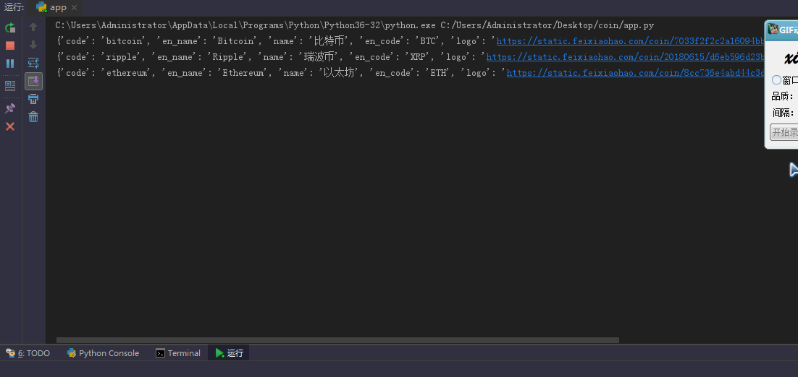
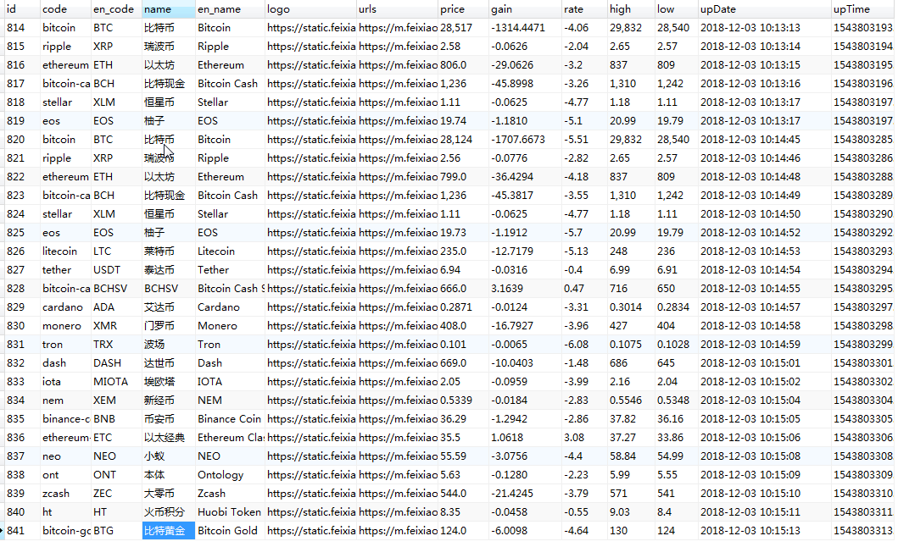

# 虚拟货币数据采集工具

Python 开发的虚拟货币数据采集工具，采集数据来源于非小号（feixiaohao.com）。

## 演示截图

<table>
    <tr>
        <td></td>
        <td></td>
    </tr>
</table>

## 特性

- 采集非小号虚拟货币数据
- 使用 BeautifulSoup 解析 HTML
- SQLite 数据库存储
- 支持批量采集
- 简单易用

## 技术栈

| 分类 | 技术 |
|------|------|
| 语言 | Python 3 |
| 解析 | BeautifulSoup |
| 数据库 | SQLite |
| 网络请求 | urllib |

## 项目结构

```
coin/
├── demo/                   # 演示截图
│   ├── 1.gif
│   └── sql.png
├── app.py                  # 主程序
├── db.py                   # 数据库操作
├── db.db                   # SQLite 数据库文件
├── requirements.txt        # 依赖
├── run.bat                # 启动脚本
├── .gitignore
└── README.md
```

## 环境要求

- Python 3.x
- Windows/Linux

## 安装

### 1. 安装依赖

```bash
pip install -r requirements.txt
```

或者

```bash
pip install urllib3 beautifulsoup4
```

### 2. 运行程序

```bash
python app.py
```

或者直接运行批处理文件（Windows）：

```bash
run.bat
```

## 主要功能

### 数据采集

- 采集虚拟货币价格
- 采集涨跌幅数据
- 采集最高价、最低价
- 采集 24 小时成交数据

### 数据存储

- 使用 SQLite 数据库存储
- 支持数据的增删改查

## 核心模块

### App 类 (app.py)

负责网页数据的采集和解析。

| 方法 | 说明 |
|------|------|
| `setUrl($url)` | 设置采集 URL |
| `getCont()` | 获取货币信息 |

### Db 类 (db.py)

负责数据库操作。

| 方法 | 说明 |
|------|------|
| `ddl($sql)` | 执行 INSERT/UPDATE/DELETE |
| `dml($sql)` | 执行 SELECT 查询 |
| `close()` | 关闭数据库连接 |

## 数据来源

- 非小号官网：https://mapi.feixiaohao.com

## 注意事项

- 请遵守网站 robots.txt 规则
- 采集频率不宜过高，建议添加延时
- 本工具仅供学习研究使用

## 相关链接

- [非小号官网](https://www.feixiaohao.com)
- [BeautifulSoup 文档](https://www.crummy.com/software/BeautifulSoup/)
- [Python urllib 文档](https://docs.python.org/3/library/urllib.html)

## 作者

- 作者：bool
- QQ：30024167
- GitHub：https://github.com/chenbool
